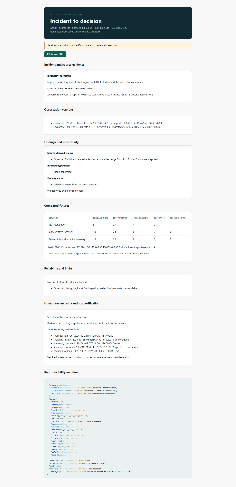
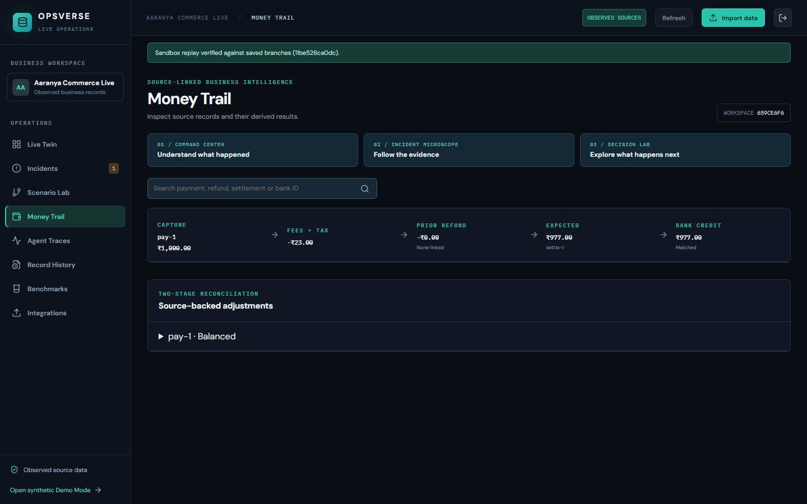
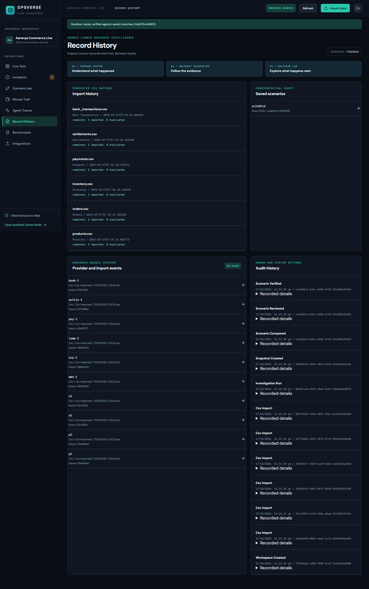
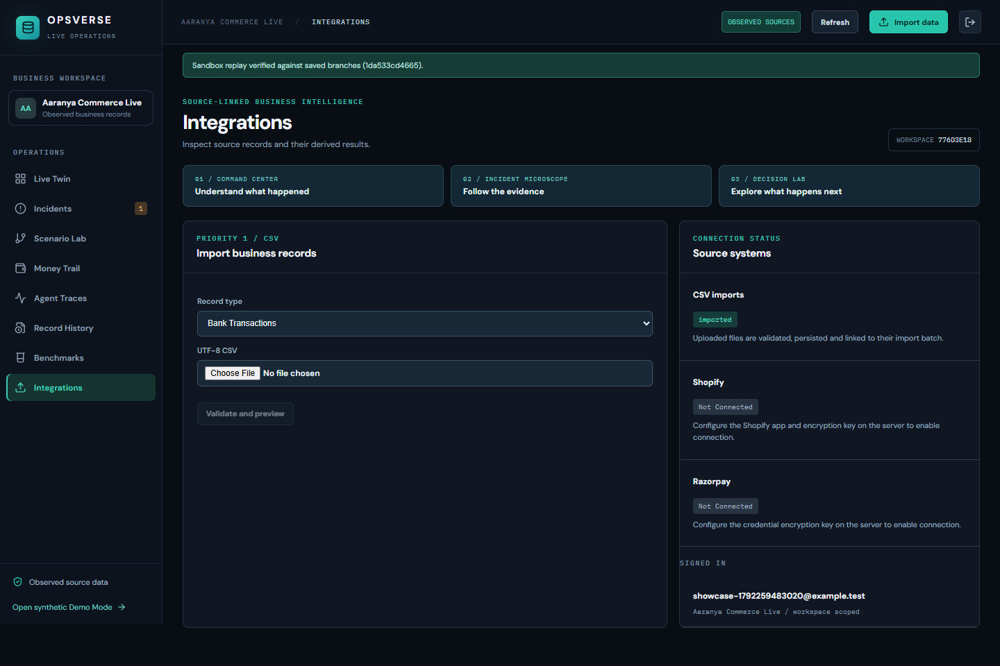
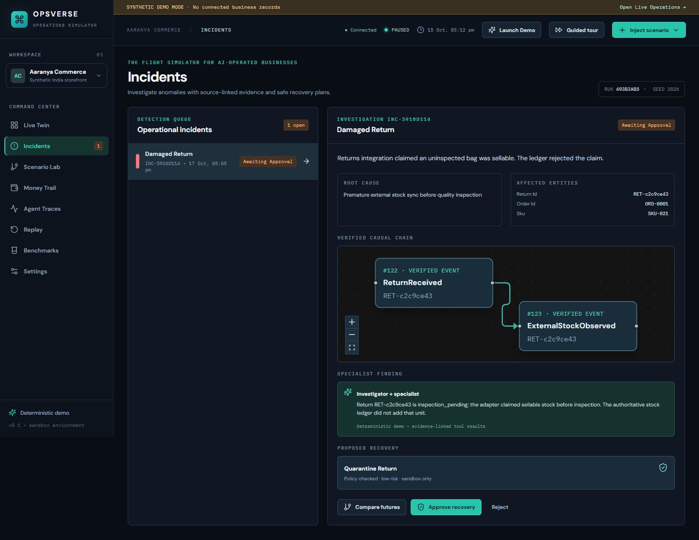
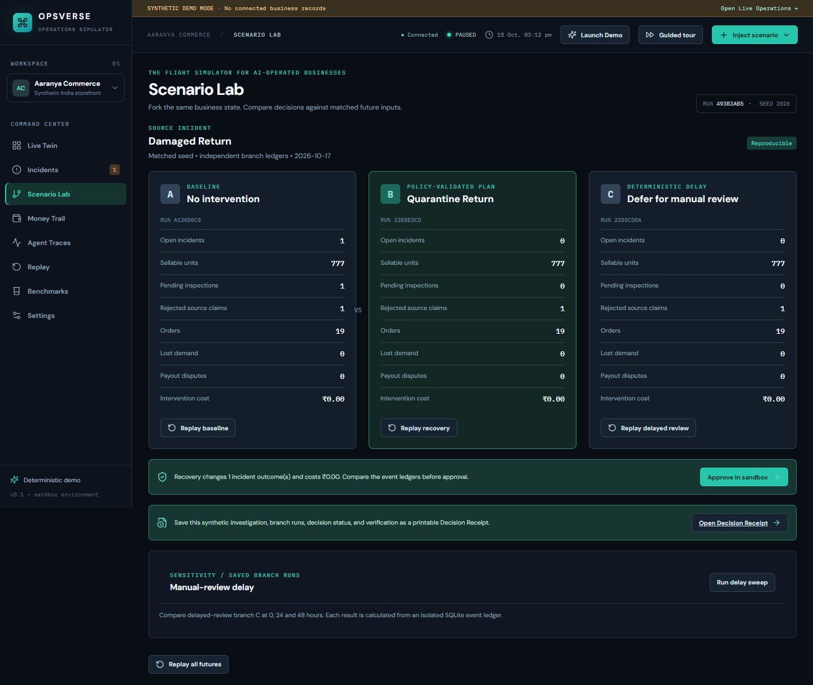
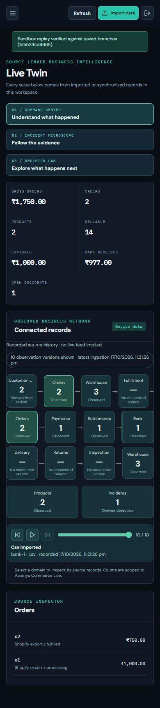
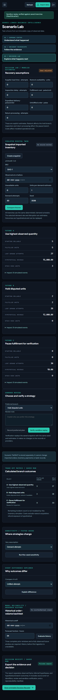
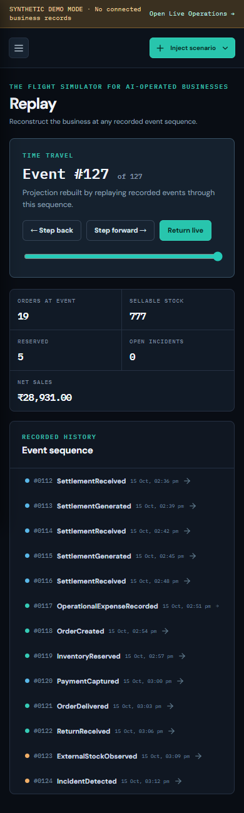
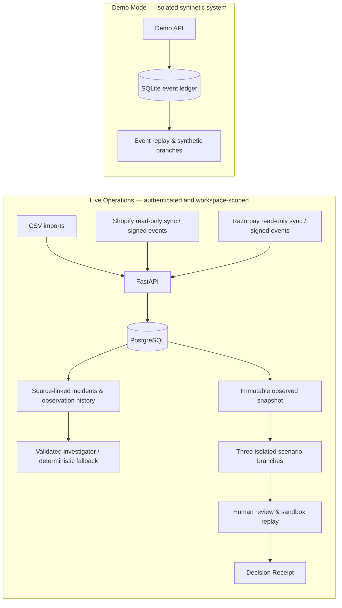

<div align="center">

# OpsVerse

### Understand what happened. Explore what happens next.

**An evidence-backed operations command center for commerce businesses.**  
Connect observed records, investigate inventory and payment discrepancies, compare possible responses, and review a reproducible decision — **without making changes to merchant systems**.

**Next.js 15 · React 19 · TypeScript · FastAPI · PostgreSQL · SQLAlchemy · Docker · Playwright**

[Explore the product](#product-tour) · [Run locally](#quick-start) · [Architecture](#architecture) · [Validation & limitations](#validation-and-limitations) · [Documentation](#documentation)

</div>

<p align="center">
  
</p>
<p align="center"><sub>Event-grounded business network in <strong>synthetic Demo Mode</strong>. Real browser capture from the repository.</sub></p>

> [!IMPORTANT]
> **Two isolated experiences.** **Live Operations** (`/live`) works with authenticated, workspace-scoped imported or authorized provider records in PostgreSQL. **Demo Mode** (`/demo`) uses a separate, deterministic SQLite event ledger and needs no merchant credentials. Investigations and scenarios are advisory; approvals and replays are **sandbox-only**, with no external inventory, payment, or refund writes.

## Why OpsVerse?

Commerce operations rarely fail in one system. An order can be marked fulfilled while inventory disagrees, a return can affect sellable stock, or a payment can reconcile differently once fees, refunds, settlement timing, and a bank credit are considered.

OpsVerse is built around a practical sequence:

**Observe the business → identify the discrepancy → inspect its evidence → explore three futures → review a decision → verify its sandbox replay.**

Instead of treating an AI-generated explanation as ground truth, OpsVerse keeps the relevant source IDs, ingestion-time observation versions, assumptions, branch events, and human review status available for inspection.

## Product tour

### 01 — Command Center: observe the business

The authenticated experience starts with actual ingested workspace records, not prefilled demo metrics. Navigate the operational network, inspect records, and find source-backed incidents across inventory, fulfillment, returns, and financial reconciliation.

<p align="center"></p>

### 02 — Incident Microscope: follow the evidence

Open a discrepancy to see the linked source records, saved observation versions, evidence graph, and investigator findings. The model-assisted investigator, when configured, is constrained to workspace-scoped read tools and validated references. Otherwise, findings are explicitly labeled as deterministic fallback.

<p align="center"></p>

### 03 — Decision Lab: compare three possible futures

Freeze an observed snapshot at an ingestion cutoff, adjust bounded assumptions, and compare three isolated inventory strategies. Explore matched event differences and seed-based sensitivity; use historical order-volume backtesting only where sufficient prior ingestion windows exist. Forecasted outcomes are hypothetical, not promises of future business performance.

<p align="center"></p>

### 04 — Decision Receipt: make decisions reviewable

Select a preferred plan for human review, verify a saved sandbox replay, and open a printable receipt with source evidence, assumptions, branch results, reproducibility information, and review status. **Review does not trigger a real provider action.**

<p align="center"></p>

### More of the workspace

<table>
  <tr>
    <td width="50%" align="center"><strong>Money Trail</strong><br /></td>
    <td width="50%" align="center"><strong>Record History</strong><br /></td>
  </tr>
  <tr>
    <td align="center"><strong>Source Integrations</strong><br /></td>
    <td align="center"><strong>Three-Futures Replay</strong><br /></td>
  </tr>
</table>

### The isolated synthetic demo

Launch **`/demo`** to explore an event-driven commerce simulation with **40 SKUs**, initial orders, suppliers, matched payouts, and costs. Inject a damaged return, settlement false alarm, supplier delay, or missing payout; compare independent branches, run a manual-review delay sweep, approve a *sandbox* action, print a receipt, and replay the append-only ledger. The guided tour runs the sequence with a reproducible seed.

<table>
  <tr>
    <td width="50%" align="center"><strong>Simulated incidents</strong><br /></td>
    <td width="50%" align="center"><strong>Scenario comparison</strong><br /></td>
  </tr>
</table>

<details>
<summary><strong>Mobile views and the full screenshot gallery</strong></summary>

<p align="center">
  
  
  
</p>

All desktop and mobile captures, including benchmarks, traces, Settings, and the demo: **[Screenshot index](docs/screenshots/README.md)**. Images are generated from real browser interactions against the local app, not evidence of a public deployment.

</details>

## Capabilities at a glance

| Area | What is implemented |
| --- | --- |
| **Live ingestion** | Atomic CSV import with mapping, preview, validation, source hashes and import history; read-only Shopify and Razorpay adapters |
| **Operational detection** | Inventory conflicts, damaged-return stock questions, fulfillment failures, excessive refunds, payout variances, missing bank credits and related source discrepancies |
| **Evidence & investigation** | Workspace-scoped source references, append-only observations, incident graph, bounded read tools, validated optional model findings and deterministic fallback |
| **Financial reconciliation** | Payment capture → fees/tax → refunds → settlement → bank credit, with integer-paise arithmetic and explicit unexplained differences |
| **Counterfactual analysis** | Versioned snapshots, three deterministic isolated branches, event-level differences, sensitivity runs and limited historical order-volume backtesting |
| **Human oversight** | Pending plan review, saved audit history, reproducible sandbox verification, printable Decision Receipt |
| **Synthetic simulation** | Separate SQLite event ledger, incident injection, guided tour, review-delay sweep, branches and replay |

## Quick start

**Requirements:** Docker with Compose. For development without Docker, use Python 3.11+, Node.js with `pnpm`, and PostgreSQL.

```bash
git clone https://github.com/avnijainnn/OPSVERSE.git
cd OPSVERSE

# Optional: start from the supplied environment template.
cp .env.example .env

# Start PostgreSQL, migrations, API, provider-sync worker and web UI.
docker compose up --build
```

| Service | Local URL |
| --- | --- |
| Web app | **http://localhost:3000** |
| Live Operations | **http://localhost:3000/live** |
| Synthetic Demo Mode | **http://localhost:3000/demo** |
| API / OpenAPI docs | **http://localhost:8000/docs** |

**Try it without credentials:** open `/demo` → **Guided tour**, or **Launch Demo** and inject an incident.

**Try the observed-data journey:** register → create a workspace → **Import data** → start with products and orders/inventory → open an incident → **Compare Recovery Strategies** → review the Decision Receipt. Refer to the [CSV schema and import order](docs/CSV_FORMATS.md) and [reproducible V2 walkthrough](docs/V2_REPRODUCIBILITY.md).

> [!CAUTION]
> The defaults in `docker-compose.yml` are **for local development only**. Before exposing even a private pilot, set a strong `POSTGRES_PASSWORD`, a distinct `SESSION_SECRET` of at least 32 characters, secure HTTPS cookies, origin restrictions, and network controls. See [Live deployment readiness](docs/LIVE_DEPLOYMENT_READINESS.md). Do not deploy the default stack as an unrestricted public SaaS.

<details>
<summary><strong>Develop without Docker Compose</strong></summary>

Provide PostgreSQL and configure `DATABASE_URL` and `SESSION_SECRET` using [.env.example](.env.example). Then start the API:

```bash
cd apps/api
pip install -e '.[test]'
python -m alembic upgrade head
uvicorn app.main:app --reload
```

In a separate terminal, from the repository root:

```bash
pnpm install
pnpm --dir apps/web dev
```

For manual live development, ensure the API actually receives the environment variables. Without `DATABASE_URL` and `SESSION_SECRET`, `/live` reports a setup error instead of fabricating business data. `/demo` can run with its separate local SQLite ledger.

</details>

## Data sources and optional AI

**CSV import (no provider account needed).** Upload one UTF-8 CSV at a time: products, orders, order items, inventory, returns, payments, refunds, settlements, and bank transactions. Mapping and validation precede an atomic import; duplicates and invalid references are reported. Uploads are limited to **5 MB / 10,000 rows**. Monetary calculations use integer paise; ISO-8601 timestamps normalize to UTC. [Field reference](docs/CSV_FORMATS.md).

**Shopify (read-only).** OAuth, a pinned `2026-10` Admin GraphQL adapter, paginated product/inventory/order/return reads, manual and scheduled sync, and verified/deduplicated webhook receiver are implemented. Configure a Shopify app, redirect URL, requested scopes and webhook subscriptions externally. Historical order permissions and connection size limits apply. **A real development-store installation and webhook delivery have not yet been verified.**

**Razorpay (read-only).** Encrypted merchant credentials, payment/refund/settlement reads, signed webhook receiver, overlapping polling and bank reconciliation are implemented and locally fixture-tested. Configure the merchant dashboard webhook yourself; scheduled polling runs via the Compose `sync` worker. **Actual merchant-account reads and webhook delivery remain unverified.**

**Optional model-assisted investigation.** Set server-side `LLM_BASE_URL`, `LLM_MODEL` and `LLM_API_KEY` to use a compatible chat-completions endpoint with bounded, workspace-scoped read tools. Invalid evidence references or responses fall back safely; model output cannot mutate authoritative records. Real model inference, accuracy, latency and cost have **not** been measured. [Model setup](docs/LLM_SETUP.md).

To store provider credentials, supply `CREDENTIAL_ENCRYPTION_KEY` generated with:

```bash
python -c "from cryptography.fernet import Fernet; print(Fernet.generate_key().decode())"
```

Treat this key as a durable secret: losing it makes encrypted provider credentials unreadable. Full callback, scope and scheduling instructions are in the [existing integration documentation](docs/REAL_WORLD_COMPLETION_GAPS.md) and [deployment guide](docs/LIVE_DEPLOYMENT_READINESS.md).

<details>
<summary><strong>Provider setup notes (Shopify, Razorpay and scheduled reads)</strong></summary>

**Shopify**

1. Set `CREDENTIAL_ENCRYPTION_KEY`, `SHOPIFY_CLIENT_ID`, `SHOPIFY_CLIENT_SECRET`, `SHOPIFY_REDIRECT_URI`, and `FRONTEND_URL`. In Shopify, allowlist the exact HTTPS callback `https://YOUR_API/live/shopify/callback`.
2. Authorize the app with `read_products`, `read_inventory`, `read_locations`, `read_orders`, and `read_returns`. The sync uses Admin GraphQL version `2026-10`; a connection with over 10,000 top-level or nested records fails explicitly rather than silently truncating data.
3. Configure the relevant order, product, inventory, refund, return, uninstall and mandatory privacy webhook subscriptions in Shopify at `https://YOUR_API/live/shopify/webhooks`. OpsVerse validates raw-body HMAC signatures and deduplicates deliveries; it does **not** create merchant-side subscriptions.
4. Standard `read_orders` has a limited recent-order window. Older history requires Shopify approval, `SHOPIFY_REQUEST_ALL_ORDERS=true`, and store reauthorization for `read_all_orders`.

**Razorpay**

1. Enter merchant API key ID and secret under **Integrations**. OpsVerse performs a read-only authentication fetch, then reads captured INR payments, refunds, settlements and reconciliation lines. Unsupported non-INR payments and captured payments without fee/tax data are reported as skipped.
2. To match the bank credit, import a bank statement CSV with `settlement_external_id` matching the Razorpay settlement ID. Fees, taxes and reconciliation arithmetic remain in integer paise.
3. To use incoming events, enter a separate webhook secret under **Integrations → Receive signed updates**, then configure the displayed HTTPS URL and matching secret in Razorpay for `payment.captured`, `refund.processed` and `settlement.processed`. The receiver validates signatures and stores event metadata; polling remains the recovery path.

**Scheduling:** `docker compose up --build` starts a `sync` worker that looks for due connections every 60 seconds and, by default, polls each at most once per 15 minutes. A non-Compose deployment can run `python scripts/sync_due_providers.py --provider razorpay` every minute. Use `PROVIDER_SYNC_INTERVAL_MINUTES` and `PROVIDER_WORKER_POLL_SECONDS` to adjust the Compose cadence. Provider connections must be configured and tested with authorized accounts before operational reliance.

</details>

## Architecture



**Trust boundary:** the demo SQLite ledger never writes into live PostgreSQL source tables. Live scenario branches save hypothetical events, not merchant writes. Incident source IDs, ingestion-time versions and review actions are persisted for auditability. See the [architecture details](docs/ARCHITECTURE.md) and [data model](docs/DATA_MODEL.md).

<details>
<summary><strong>Repository structure</strong></summary>

```text
OPSVERSE/
├── apps/
│   ├── api/              # FastAPI, live data model, migrations, demo engine, tests
│   └── web/              # Next.js UI and Playwright journeys
├── docs/
│   ├── screenshots/      # Real desktop/mobile captures
│   └── *.md              # Architecture, guides, audits and requirements
├── deploy/               # Controlled private-pilot configuration
├── reports/              # Synthetic benchmark and detector-fixture results
├── scripts/              # Benchmarks, providers and reproducible fixtures
├── docker-compose.yml
└── .env.example
```

</details>

## Tests and reproducibility

```bash
# API tests (PostgreSQL-only checks require POSTGRES_TEST_URL)
python -m pytest apps/api/tests -q

# Type check, production build and real-browser journeys
pnpm --filter @opsverse/web lint
pnpm --dir apps/web build
pnpm --dir apps/web exec playwright test

# Synthetic reproducibility benchmark
python scripts/benchmark.py --seed 2026 --output reports/benchmark.json
```

For the database-specific checks, set `POSTGRES_TEST_URL` to a **disposable** PostgreSQL database. Browser journeys for Live Operations require the real API and PostgreSQL; the demo uses its isolated SQLite ledger. [Exact test setup](docs/V2_REPRODUCIBILITY.md).

### What the evidence actually supports

| Evidence | Scope / limitation |
| --- | --- |
| **16 labeled live-detector CSV workspaces** | 7 positive and 9 negative curated fixtures; not a representative merchant-population accuracy estimate. [Fixture report](reports/live_detection_fixtures.json) |
| **20 seeded synthetic benchmark runs** | Four injected incident types; checks deterministic branches, persisted replay and sandbox verification, **not** AI uplift or real recovery performance. [Benchmark report](reports/benchmark.json) |
| **Local API, PostgreSQL and browser checks** | Documented suites include successful API runs, schema/ledger/webhook checks, a production build, and Chromium journeys against a locally running stack. **These are local checks, not remote production or provider validation.** [Validation report](docs/VALIDATION_AND_LIMITATIONS.md) |

## Validation and limitations

OpsVerse is a **locally tested prototype / controlled-private-pilot candidate**, not a verified production deployment.

- **External accounts remain unverified.** Shopify and Razorpay contracts, HMAC fixtures and provider-sync paths were tested locally; real account authorization, actual provider responses, and real webhook deliveries still need end-to-end checks.
- **Model outcomes remain unmeasured.** A compatible LLM endpoint is optional; without one, investigations use deterministic fallback. Real model accuracy, cost and latency have not been verified.
- **Historical knowledge is bounded by ingestion.** Old business timestamps imported today do not become observations the system could have known yesterday. The backtest evaluates **order-volume projection**, not causal recovery success or SKU-level forecast accuracy.
- **Scenarios are hypothetical.** Three-branch results depend on recorded snapshots and bounded assumptions. No provider-facing changes are executed, even after review.
- **Public launch needs additional hardening.** Managed database and secrets, backups, HTTPS, secure cookies, registration/edge controls, distributed rate limiting, retention, monitoring, background-job limits, and failover checks are outstanding.

See [real-world completion gaps](docs/REAL_WORLD_COMPLETION_GAPS.md), [validation matrix](docs/VALIDATION_AND_LIMITATIONS.md), [V2 implementation audit](docs/IMPLEMENTATION_GAP_AUDIT.md), and [Live deployment readiness](docs/LIVE_DEPLOYMENT_READINESS.md) for the precise verified/unverified boundary.

## Documentation

| Guide | Purpose |
| --- | --- |
| [Cofounder walkthrough](docs/COFOUNDER_DEMO.md) | Fast no-credential product tour and Live path |
| [CSV formats](docs/CSV_FORMATS.md) | Required import fields, ID linking and money units |
| [V2 reproducibility](docs/V2_REPRODUCIBILITY.md) | Recreate the incident-to-decision journey |
| [Architecture](docs/ARCHITECTURE.md) · [Data model](docs/DATA_MODEL.md) | Services, persistence and trust boundaries |
| [LLM setup](docs/LLM_SETUP.md) | Optional bounded model interpretation |
| [Showcase deployment](docs/DEPLOYMENT_SHOWCASE.md) · [Live pilot readiness](docs/LIVE_DEPLOYMENT_READINESS.md) | Deployment boundaries and operator checklist |
| [Validation and limitations](docs/VALIDATION_AND_LIMITATIONS.md) · [V2 audit](docs/IMPLEMENTATION_GAP_AUDIT.md) | Local test evidence and outstanding work |
| [Screenshot gallery](docs/screenshots/README.md) | Desktop/mobile browser captures |

---

<div align="center">

**OpsVerse — from operational evidence to reproducible decisions.**

Built by [Avni Jain](https://github.com/avnijainnn) · [View source on GitHub](https://github.com/avnijainnn/OPSVERSE)

</div>