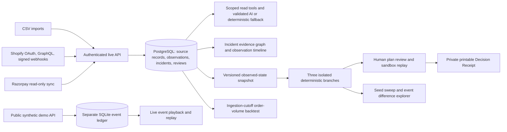

# OpsVerse architecture

## Trust boundary

`/live` and `/demo` are different data products. Live APIs require a signed session and a workspace membership check, and they query SQLAlchemy tables through `DATABASE_URL` (PostgreSQL in Compose). The synthetic simulator retains its separate SQLite event ledger and public demo-only routes. No import or provider sync calls a demo seeding function. A scenario copied from live data stores an immutable JSON snapshot and counterfactual results in the live database; it does not update operational source tables.

## Live ingest and provenance

A CSV upload is decoded as UTF-8, parsed with a row limit, normalized to integer paise and UTC timestamps, checked for source-ID conflicts, and committed in one transaction with its import batch and derived incidents. Each normalized record retains a source system, external ID, batch ID and original row. Linked records resolve internal foreign keys only within the same workspace. The dashboard and Money Trail query these persisted records; they are not projections of synthetic demo events.

The current detection pass classifies inventory disagreement, damaged-return stock concerns, excessive refunds, failed fulfillment, payout variances, missing bank imports and unmatched bank credits. An incident holds references to exact imported records. The Incident Microscope derives a graph from those references and linked observation versions. Detector-input links are derived, normalized-version links are observed, and same-SKU/location links are inferred; none is presented as proven physical causality. Missing source or version references are explicit. Investigations can use workspace-scoped typed read tools; an optional compatible model may request bounded tools and return JSON citing only available IDs. A deterministic fallback remains available. No model result is an authoritative state mutation.

## Live counterfactuals

The snapshot freezes imported operational types at a selected ingestion cutoff and hashes their canonical representation. The implemented scenario takes a disputed SKU, generates a deterministic matched-demand schedule from its seed, and compares three policies: highest observed quantity, held disputed units with optional restock, and paused fulfillment with optional inspection release. Demand, restock, delay and cost inputs are bounded estimates saved with the scenario. Sensitivity reruns the saved snapshot over explicit values and seeds; displayed ranges are sampled ranges, not confidence intervals. The difference explorer joins matched demand IDs across saved event traces. Each result timeline is persisted as hypothetical data. The source digest is checked around comparison to verify that scenario execution did not alter imported data.

The historical backtest uses both business event time and observation ingestion time. It evaluates a weighted order-volume projection at rolling cutoffs against two prespecified baselines. Predictions at cutoff T can read only observations ingested by T. The API returns an insufficient-history state unless three prior order-source windows and a later observed window exist. It stores valid runs in the workspace audit ledger. This evaluates a simulator demand input, not causal effectiveness of recovery policies; inventory, returns, settlement timing and recovery estimates remain outside the validated metric.

Money Trail reconciles integer-paise payment capture through recorded fees/refunds to a settlement, then linked bank credits. The output separates recorded adjustments from unexplained provider or bank variance and exposes source IDs along the payment-to-bank path. Decision Receipts read saved incidents, observations, investigations, snapshots, branches, audit records and optional backtest evidence. Printable HTML and a JSON manifest exclude raw source payloads and credentials.

Expensive authenticated analysis routes have a per-process, per-user and per-workspace minute budget. This reduces accidental local overload but is not a distributed production rate limiter; public hosting needs a shared store or edge control. Scenario inputs and sensitivity sweep sizes are bounded, and backtests cap loaded observation rows and rolling origins.

## Synthetic demo engine

The original demo uses an append-only SQLite event ledger with run-scoped sequence numbers, simulation timestamps, wall-clock recording times and causation IDs. Pure reducers enforce stock, return, refund and settlement invariants. The browser uses WebSocket sequence catch-up after disconnects. Three branches copy events at a fork sequence, remap causal IDs, and apply matched demand before comparison: no intervention, immediate typed recovery and delayed manual review. A bounded delay sweep creates separate saved branch runs. Sandbox approvals recheck the expected parent sequence and store verification results. The four injected incidents, guided tour, print receipt and replay remain available at `/demo`.

## Persistence and known migration boundary

`apps/api/migrations` owns the PostgreSQL live schema. The legacy demo schema is bootstrapped by `store.py` into SQLite. Existing synthetic ledgers are deliberately not copied into live workspaces. The empty-database Alembic migration, append-only observation trigger, privacy-redaction exception and concurrent webhook idempotency have been exercised on PostgreSQL 14 in a disposable local WSL database. CI runs the same PostgreSQL checks against PostgreSQL 16. Failover and managed-service operations remain unverified.
